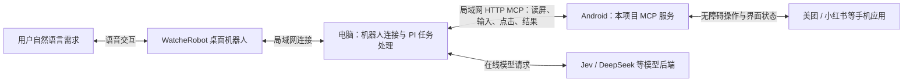

# WatcherRobotPhone

**让 WatcheRobot 从“陪你聊天”，走向“帮你操作手机”。**

京东 48 小时创作营项目。用户向桌面机器人提出自然语言需求，机器人通过局域网连接电脑，由电脑上的 PI 调用本项目的手机端 MCP，控制 Android 应用并读取操作结果。重复流程可以通过示教生成 Skill，再定位、验证和复用。

## 当前技术链路

机器人负责语音交互与反馈，电脑上的 PI 负责组织任务和调用工具；手机端运行本项目 MCP，通过无障碍服务操作应用、读取节点和截图。手机执行后的界面状态回传电脑，供后续决策和结果验证。机器人业务连接复用现有 SDK/设备通道，MCP 是电脑到手机的工具连接。

**当前控制路径使用局域网与手机 MCP。ESP32 BLE HID、USB HID 和机器人摄像头拍屏属于前期调研，不承担本次手机操作。** 各演示所用模型与配置按对应实测记录区分；本地 Skill 命中时可跳过模型请求。

## 已展示的能力

现场视频：[京东创造营现场｜让 AI 操作真实手机](https://www.xiaohongshu.com/discovery/item/6ad3c336000000001402ebd7?source=webshare&xhsshare=pc_web&xsec_token=ABBoFwwcmUXezu3hfE3BT0LQlge7vTDLIcNUBMpKQxugQ=&xsec_source=pc_share)。

- **机器人语音操作美团**：提出晚饭、汉堡需求后，手机执行商家搜索、选购和订单流程；演示显示“支付成功”。用户随后语音要求取消，最终显示“订单已取消”。实机演示已上传一版至飞书问卷，支付确认方式未完整拍出。
- **手机示教到 Skill**：在 Orulink Control 录制并提交，电脑完成 PI 验证、生成、复用与安装，再回报手机结果。[实机闭环记录](docs/research/app-workflow-loop.md)。
- **固定流程复用**：小红书同一任务的 Jev 与 Skill 模式各3轮均成功；中位全程从22.537秒降至15.594秒，减少30.8%，每轮模型调用14→0。结果仅覆盖该固定任务、版本和小样本。[对照实验](docs/results/phone-record-replay-20261018.md) · [小红书视频：录一遍手机操作，让 AI 照着完成整套流程](https://www.xiaohongshu.com/discovery/item/6ad3cbb0000000000202bff4?source=webshare&xhsshare=pc_web&xsec_token=ABBoFwwcmUXezu3hfE3BT0LfZssYEaD_U-VYZ149DwzNo=&xsec_source=pc_share)。
- **参数化任务**：已实测更换搜索词后只收藏、按精确标题取消收藏，点赞保持不变；该模式仍由模型逐步判断。[经验辅助与验收](docs/research/phone-experience.md)。

美团演示由团队确认完成；它与仓库中的小红书测速分别留证，不能混用任务耗时或模型配置。最终冻结版本仍在修改，当前 main 不自动代表最终提交版。

## 使用条件与边界

需要解锁的 Android 手机、已开启的无障碍/MCP 服务、配置好的电脑和可互通局域网。日常 PI 手机操作通过 LAN MCP，无需持续连接 USB；ADB 仅用于部分历史安装、诊断和实验准备。ROG 魔盒 Air 提供局域网路由与无线网络，Mac Studio 用于可选本地模型研究。

PI、任务策略、MCP 和 Skill 执行在本地，在线模型通过云 API 调用。录制生成入口目前限定已验证示例，经验模式覆盖小红书搜索及点赞/收藏任务族；不代表任意应用或任意录制都可直接执行。长时后台稳定性和更多机型仍需验证，详细失败记录见各实测文档。
