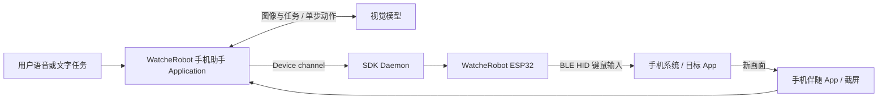

# WatcherRobotPhone

**让 WatcheRobot 从“陪你聊天”，走向“帮你操作手机”。**

京东 48 小时创作营项目。我们计划为 WatcheRobot 新增一个手机操作助手 Application：用户用自然语言或语音描述任务，AI 理解手机屏幕，通过 ESP32 模拟键鼠完成点击、输入和页面切换，再观察结果，逐步完成任务。

> 当前阶段：仓库初始化与技术调研。尚未完成 WatcheRobot 集成或端到端实机验证；下文的目标能力不代表已经实现。

## 评委从这里开始

| 想了解什么 | 入口 |
| --- | --- |
| 项目要解决什么、展示什么 | [项目说明](docs/project.md) |
| 48 小时准备做哪些事情 | [实施计划与验收标准](docs/plan.md) |
| WatcheRobot 如何接入 | [技术架构](docs/architecture.md) |
| 手机 App + ESP32 怎么实现 | [路线一源码调研](docs/research/phone-app-esp32.md) |
| 逐步查看截图、模型、BLE、HID 的信息流 | [交互架构图 HTML](docs/dataflow.html) · [查看方式](docs/research/README.md) |
| 目前做到了哪一步、如何验收 | [评审与演示说明](docs/judges.md) |
| 本地模型部署、变更记录与速度实测 | [本地模型部署记录](docs/local-model-deployment/README.md) |

## 本次优先实现的路线

**先跑通一次可靠的“观察 → 决策 → 操作 → 再观察”。** 第一阶段选择大按钮、短流程的任务，例如打开目标 App、搜索商品并进入详情页；生活服务长流程是后续扩展方向。

图中为 WatcheRobot 接入提案，图像接入协议与 HID 服务尚待实现。第三方参考实现把 Agent 放在手机 App 内，与本项目拟采用的 SDK Application 架构存在差异。

## 两条技术路线

| 路线 | 如何看屏幕 | 如何操作 | 当前决定 |
| --- | --- | --- | --- |
| 手机 App + ESP32 | 手机系统授权截屏，上传视觉模型 | ESP32 模拟键鼠 | 优先验证 |
| 机器人摄像头 + ESP32 | 拍摄手机、定位屏幕、裁切与校正 | ESP32 模拟键鼠 | 保留为后续探索 |

本次已有的可核验参考是 iPhone 项目 `boboabw/phone-agent`，固定到 commit `a90045074afcd4de69f885fba25b0b171d690f45`。目标手机平台需先实测确定；不能将 iOS 参考代码视为可直接用于 Android。

## 当前进度

- [x] 明确项目目标、两条路线与首选方向。
- [x] 拉取并静态分析参考项目的全部 ESP32 固件及关键 App 源码。
- [x] 梳理截图、模型、坐标校准、BLE 控制、HID 与结果反馈。
- [x] 建立公开参赛资料入口及交互架构图。
- [ ] 确认目标手机与系统截屏能力。
- [ ] 验证 HID 配对、校准与大按钮点击。
- [ ] 接入 WatcheRobot Application 与设备通道。
- [ ] 跑通端到端演示并补充测试数据、录屏与照片。

## 仓库范围

本仓库承载黑客松的项目说明、技术调研、Application 集成与演示资料。WatcheRobot SDK、Daemon 和既有固件保留在各自源码仓库，后续适配通过明确的接口与配套提交关联，不在此复制另一份 Daemon。

初始化内容为文档与可离线打开的 HTML，无需安装依赖。实现进入本仓库后，再补充实际启动与测试命令。
