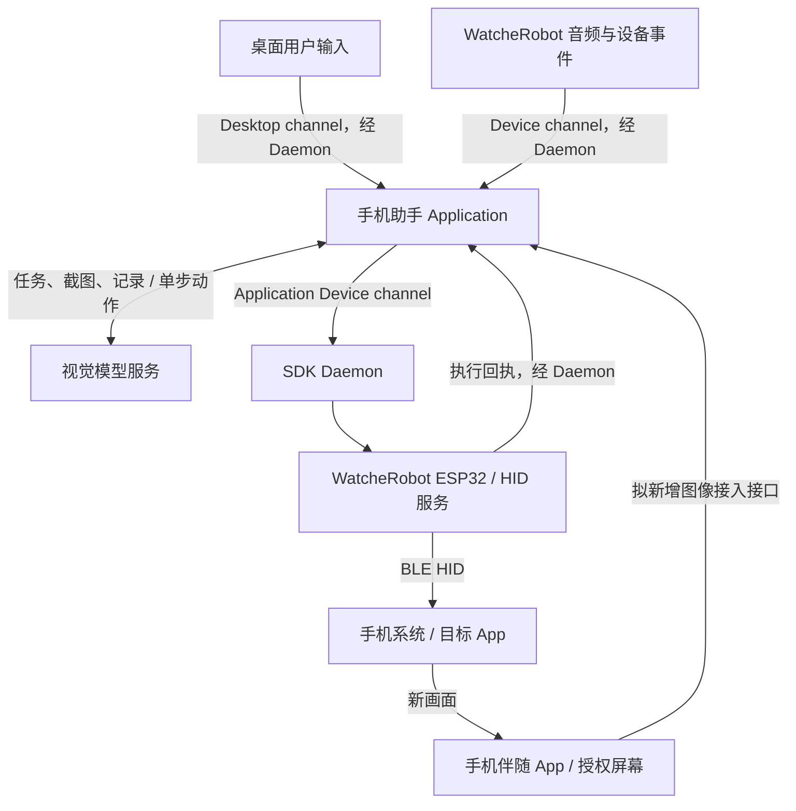

# WatcheRobot 接入架构

> 本页是设计提案，尚未完成集成。第三方参考实现的现状见[路线一调研](research/phone-app-esp32.md)。

## 模块分工

| 模块 | 职责 |
| --- | --- |
| 手机伴随 App | 系统授权截屏、图像尺寸与流标识、上传图像、权限和会话生命周期 |
| 手机助手 Application | 用户任务、机器人语音接入、视觉模型请求、动作校验、坐标转换、结果观察与任务状态 |
| SDK Daemon | Application 生命周期与现有连接管理；对业务帧做内容无关的路由 |
| WatcheRobot ESP32 | 接收设备动作，调度 HID 轨迹、键鼠报告、释放与状态回执 |
| 手机操作系统 | 接收标准 HID 输入并作用于当前目标 App |
| 视觉模型服务 | 根据用户任务、当前截图和记录返回单步动作 |

## 任务与动作信息流

手机图像接口是拟新增能力，尚未选定具体传输和鉴权实现。不会把未知 SDK API 写成已存在能力。

## 架构边界

- Daemon 唯一源码归属 WatcheRobot Python SDK；本仓库不复制或维护第二份 Daemon。
- Application 由 Daemon 管理，使用其注入的 Desktop channel 与 Device channel。
- Application 运行时，Desktop 与 Device 业务帧进入当前 Application；Application 下发设备动作必须走 Device channel。
- Daemon 不根据业务消息类型解析、改写或增加直达设备的旁路。
- Application 未运行时，既有 Desktop / Device 透明转发规则保持不变。
- 连接管理 REST 与业务操作帧分离。

## 从参考实现迁移的内容

参考项目在手机中运行 AgentEngine、VisionClient、MouseExecutor 和 BLETransport；拟议方案把任务编排、模型调用与坐标转换放到 WatcheRobot Application。可借鉴板端轨迹、HID 报告与回执设计，但需要改造输入接口，不能直接覆盖现有机器人固件入口。

若后续决定让 Agent 全部留在手机，需另行定义 Application 与手机 Agent 的任务委托协议，并记录架构变更。

## 核心数据合同（待落实）

- 图像：任务会话、流标识、像素尺寸、采集/确认时间、方向与压缩数据。
- 模型动作：动作类型、归一化坐标、参数、关联观察帧。
- 设备动作：序号、校准版本、轨迹/键盘参数、取消与释放语义。
- 执行回执：序号、busy、error；业务结果由后续屏幕确认。

## 现有配置差异

前期对 WatcheRobot 本地 S3 默认配置的静态调查显示：NimBLE 最大连接数为 1，未启用安全；参考配件配置为 2 个连接并启用加密。该比较不是实机运行配置证明。集成前需要评估配网服务共存、持久配对、连接数量、Wi-Fi/BLE 共存及内存。
