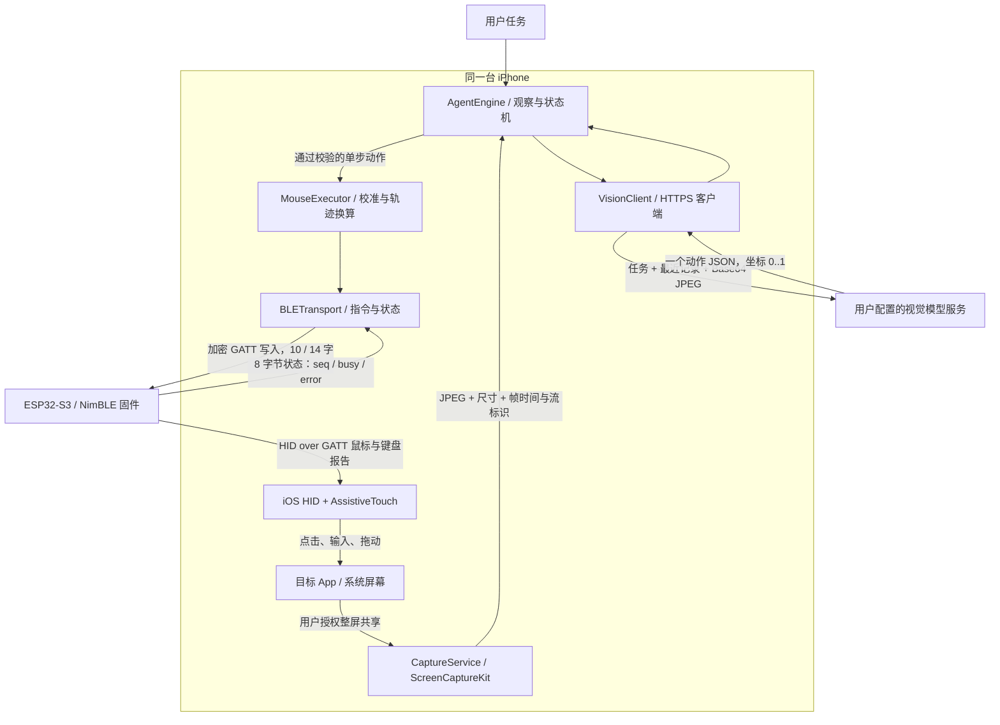
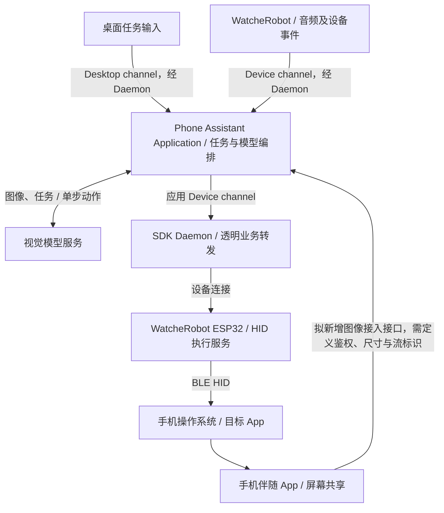

# 路线一：手机 App + ESP32 键鼠源码调查

> 这是第三方参考实现的静态研究。WatcheRobot 接入设计见[技术架构](../architecture.md)，当前项目状态见[评审说明](../judges.md)。

## 来源与调查边界

- 仓库：[boboabw/phone-agent](https://github.com/boboabw/phone-agent)
- 固定版本：`a90045074afcd4de69f885fba25b0b171d690f45`。
- 调查日期：2026-10-16，Asia/Shanghai。
- 归属说明：这是与需求吻合的公开实现，尚未证实为 `@openmys` X 视频所用代码。作者公开仓库 `JosssphZhou/groki-bot` 的 README 描述机器人固件、语音网关和 Grok Bot 任务转交，不足以确认视频手机控制链路。
- 下载方式：`gh repo clone` 遇到 `Empty reply from server`；随后通过已登录 `gh api` 按固定 commit 下载全部 `firmware/` 文件、关键 App/Shared 源码和文档，共 22 个文件。不是完整 Git checkout；未下载演示媒体、其余页面与非核心服务。
- 证据等级：以下为静态源码确认；未构建 iOS App、未烧录固件、未配对手机、未调用真实模型。仓库宣称的演示效果不等于本次实测。

## 结论

该方案的视觉与 Agent 主循环在手机 App 中，模型在用户配置的兼容服务中。ESP32 是 BLE HID 执行配件：收 App 的 GATT 控制包，再向手机操作系统发送标准鼠标/键盘报告。屏幕图像不经过 ESP32，不需要机器人摄像头，核心链路不依赖 ESP32 Wi-Fi。

同一台手机有两个不同的蓝牙角色：App 作为 CoreBluetooth 控制客户端，操作系统作为 HID 输入主机。固件分别维护 `control_connection`、`hid_connection`、`keyboard_connection`，最多保留两个物理 BLE 连接；不能把逻辑角色直接等同为三条物理连接。

## 框架图：参考实现现状



## 一次动作的信息流

1. 用户在系统选择器共享整屏。`CaptureService` 使用 `SCContentSharingPicker` 和 `SCStream`，不使用外部摄像头，也不是此版本中的 ReplayKit 实现。
2. 完整帧经 CoreImage 缩放，默认最长边 1280，JPEG 质量 0.72；本地图像转换按 0.25 秒节流，约最多 4 次/秒。这不是模型调用帧率。
3. `AgentEngine` 等待可用整屏，读取图像与任务，交 `VisionClient` 调用配置的 HTTPS 端点；OpenAI-compatible Chat Completions 请求内包含任务、最近 12 条记录、图像尺寸及 Base64 JPEG，非流式，单请求超时 45 秒。
4. 模型每轮只返回一个动作 JSON。坐标在整张图中归一化到 0..1；支持 tap、long_press、drag、scroll、type、press_key、wait、finish、ask_user 等。
5. JSON 先做结构与边界校验。执行前重新检查捕获流、原始尺寸、模型图像尺寸，以及缩略图差异；画面改变则丢弃旧动作、重新观察。
6. `MouseExecutor` 把归一化坐标乘以校准屏幕尺寸，再用拟合矩阵换算成相对鼠标单位。每次新目标先向左上角做物理归零，再从该基准移动；不是向 HID 发送屏幕绝对坐标。
7. `BLETransport` 向配件自定义 GATT 特征写入命令。板端接收整段轨迹，按固定间隔拆成 HID 相对位移报告；默认运动模型间隔为 40 ms。App 等待相同序号且 `busy=false` 后才继续点击。
8. iOS 的 HID 与 AssistiveTouch 将鼠标报告转换为指针/点击；键盘报告提供 ASCII 与修饰键。中文需要输入法拼音及候选选择，不能直接发送 Unicode。
9. 目标 App 更新后，采集新画面进入下一轮；是否完成由模型结合新画面判断。固件回执只说明动作执行状态，不能证明下单或页面跳转成功。

## 协议与具体示例

模型动作（示例，不是真实运行记录）：

```json
{"kind":"tap","x":0.5,"y":0.7,"x2":null,"y2":null,"text":null,"amount":null,"seconds":null,"reason":"打开搜索"}
```

App -> ESP32 使用 `A1000001...` 自定义服务，其中 `A1000002...` 为命令、`A1000003...` 为状态、`A1000004...` 为任务灯效。ESP32 -> iOS 使用标准 HID 服务 `0x1812`。

| 数据 | 长度 | 结构 / 含义 |
|---|---:|---|
| 基础鼠标命令 | 10 字节 | version=1、op、seq UInt16LE、buttons、dx Int8、dy Int8、wheel Int8、delay UInt16LE |
| 键盘命令 | 10 字节 | version=1、op=4、seq、modifier、keyUsage，剩余为零 |
| 缓冲轨迹 | 14 字节 | version=2、op=5、seq、buttons、dx Int16LE、dy Int16LE、reportCount UInt16LE、intervalMS UInt16LE、reserved=0 |
| 状态 | 8 字节 | version、flags、buttons、error、seq UInt16LE、capabilities、revision/LED flags |
| 鼠标 HID 报告 | 4 字节 | buttons、dx、dy、wheel；Boot 模式 3 字节，不含滚轮 |
| 键盘 HID 报告 | 8 字节 | modifier、reserved、key usage 等；App 按下后再释放 |

例如基础左键 click，序号 1，零延迟：`01 02 01 00 01 00 00 00 00 00`。固件按定时回调发按下，再约 60 ms 后释放。鼠标移动必须先完成，不能拿这个 click 包直接指定屏幕坐标。

## 关键源码证据

以下链接均固定到本次版本，行号由下载源码核对。

| 模块 | 源码 | 关键点 |
|---|---|---|
| 捕获 | [CaptureService.swift:47](https://github.com/boboabw/phone-agent/blob/a90045074afcd4de69f885fba25b0b171d690f45/PhoneAgent/Services/CaptureService.swift#L47) | 用户授权、帧来源与失效管理 |
| 捕获 API | [CaptureService.swift:131](https://github.com/boboabw/phone-agent/blob/a90045074afcd4de69f885fba25b0b171d690f45/PhoneAgent/Services/CaptureService.swift#L131) | 系统共享选择器、SCStream |
| JPEG | [CaptureService.swift:263](https://github.com/boboabw/phone-agent/blob/a90045074afcd4de69f885fba25b0b171d690f45/PhoneAgent/Services/CaptureService.swift#L263) | 缩放与质量 0.72 |
| 模型协议 | [VisionClient.swift:58](https://github.com/boboabw/phone-agent/blob/a90045074afcd4de69f885fba25b0b171d690f45/PhoneAgent/Services/VisionClient.swift#L58) | 单步 JSON、归一化坐标与输入限制 |
| 模型请求 | [VisionClient.swift:118](https://github.com/boboabw/phone-agent/blob/a90045074afcd4de69f885fba25b0b171d690f45/PhoneAgent/Services/VisionClient.swift#L118) | 任务历史、Base64 JPEG、HTTPS POST |
| 新鲜度 | [AgentEngine.swift:202](https://github.com/boboabw/phone-agent/blob/a90045074afcd4de69f885fba25b0b171d690f45/PhoneAgent/Services/AgentEngine.swift#L202) | 最近 1.5 秒系统确认的画面，最多等 6 秒 |
| 主循环 | [AgentEngine.swift:340](https://github.com/boboabw/phone-agent/blob/a90045074afcd4de69f885fba25b0b171d690f45/PhoneAgent/Services/AgentEngine.swift#L340) | 观察、校验、执行、再观察、停止与释放 |
| 指针执行 | [MouseExecutor.swift:37](https://github.com/boboabw/phone-agent/blob/a90045074afcd4de69f885fba25b0b171d690f45/PhoneAgent/Services/MouseExecutor.swift#L37) | 向左上归零，板端缓冲运动 |
| 目标换算 | [MouseExecutor.swift:104](https://github.com/boboabw/phone-agent/blob/a90045074afcd4de69f885fba25b0b171d690f45/PhoneAgent/Services/MouseExecutor.swift#L104) | 目标归一化坐标 -> 相对单位 |
| 坐标拟合 | [AgentModels.swift:148](https://github.com/boboabw/phone-agent/blob/a90045074afcd4de69f885fba25b0b171d690f45/Shared/AgentModels.swift#L148) | origin、gain 与轴交叉项 |
| 数据包 | [MouseProtocol.swift:4](https://github.com/boboabw/phone-agent/blob/a90045074afcd4de69f885fba25b0b171d690f45/Shared/MouseProtocol.swift#L4) | UUID、10/14 字节包、8 字节状态 |
| 完成等待 | [BLETransport.swift:187](https://github.com/boboabw/phone-agent/blob/a90045074afcd4de69f885fba25b0b171d690f45/PhoneAgent/Services/BLETransport.swift#L187) | GATT 写确认之外，还等待 seq 与 busy |
| HID 发送 | [main.c:155](https://github.com/boboabw/phone-agent/blob/a90045074afcd4de69f885fba25b0b171d690f45/firmware/main/main.c#L155) | 标准报告通知给手机系统 |
| 轨迹调度 | [main.c:207](https://github.com/boboabw/phone-agent/blob/a90045074afcd4de69f885fba25b0b171d690f45/firmware/main/main.c#L207) | 累计舍入、定时与忙碌状态 |
| 命令入口 | [main.c:276](https://github.com/boboabw/phone-agent/blob/a90045074afcd4de69f885fba25b0b171d690f45/firmware/main/main.c#L276) | 长度、范围、加密、ready 与 busy 检查 |
| 服务注册 | [main.c:431](https://github.com/boboabw/phone-agent/blob/a90045074afcd4de69f885fba25b0b171d690f45/firmware/main/main.c#L431) | HID、自定义控制、键盘和状态特征 |

## 接入 WatcheRobot 的差异与建议（设计提案，尚未实现）

原仓库中的 iPhone App 是独立客户端，不是 WatcheRobot SDK Application，原仓库没有 SDK Daemon。要做成 WatcheRobot Application，需要新增适配，不应把上图误读为现有 WatcheRobot 功能。

建议以一个独立手机助手 Application 承担任务状态、模型调用、坐标换算和业务动作。手机伴随 App 保留系统屏幕共享与图像上传。机器人语音接入、模型动作下发均走 Application 的通道，Daemon 维持内容无关的转发。



这会把参考实现的 AgentEngine / VisionClient / 坐标换算迁到 Application；固件仍保持轨迹调度、HID 与执行回执。手机图像接口是拟新增能力，当前未确认可复用的具体 SDK 图像传输 API。若决定让全部 Agent 继续在手机运行，则另需定义 WatcheRobot Application 与手机 Agent 的任务委托协议，不能仅改个名字便声称已完成 Application 接入。

当前本地 WatcheRobot S3 的 `firmware/s3/sdkconfig.defaults:72` 启用 NimBLE，但 `:84` 最大连接数为 1，`:89` 未启用安全。参考固件为 2 连接、启用加密/持久配对。必须评估现有配网服务的生命周期、GATT 服务共存、连接预算、Wi-Fi/BLE 共存与内存；不能直接复制外部 `main.c` 或整份 sdkconfig 覆盖机器人固件。

参考 README 声明 iOS 27 / Xcode 27 / ESP-IDF 5.5.4；本次确认代码使用 ScreenCaptureKit，但未验证这套系统与工具链在目标手机上的实际可用性。若采用 Android，要改为 Android 原生采集、授权与后台执行实现，BLE 及 HID 设计可参考，Swift 源码不能直接复用。

## 48 小时验证顺序（建议）

1. 先用独立 S3 配件验证目标手机能配对、移动、点击、释放；确认 AssistiveTouch / 手机 HID 行为。
2. 验证手机整屏授权及切换到目标 App 后仍有新帧；这是 App 路线的首要平台门槛。
3. 完成校准，固定竖屏与指针速度，用大按钮验证定位误差。
4. 单步接模型，先选开闹钟或导航到商品详情；记录截图、动作、状态及耗时，不以写入成功代替结果检查。
5. 最后接入 SDK Application 的任务与 Device channel；做出最小演示后再评估中文输入、支付及长任务。

## 验证记录

- 已静态逐项核对上表的主链路、数据包及调用关系。
- 未进行外部项目编译、测试、手机权限测试或硬件实测。
- 本文是实现分析与适配提案，不能作为已实现或已验证的产品能力声明。
